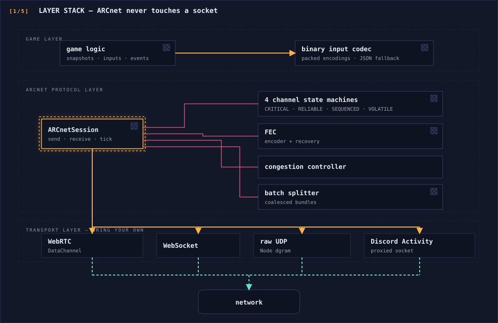
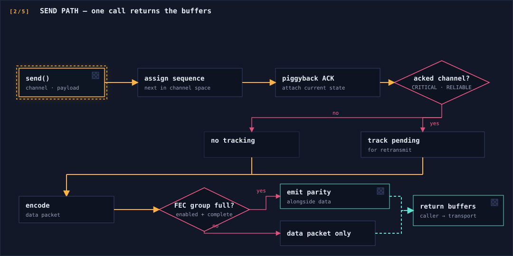
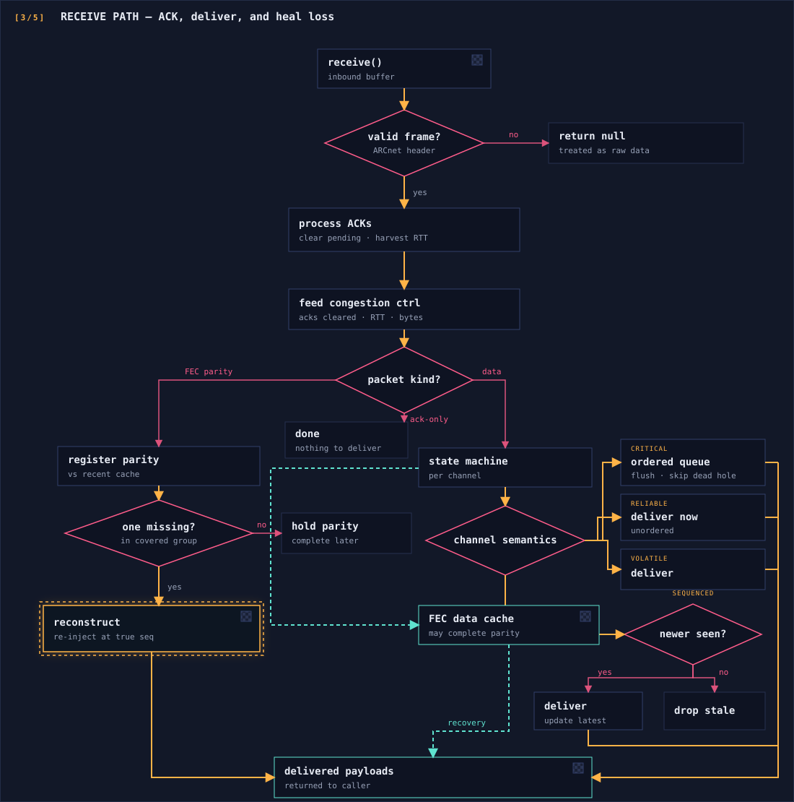
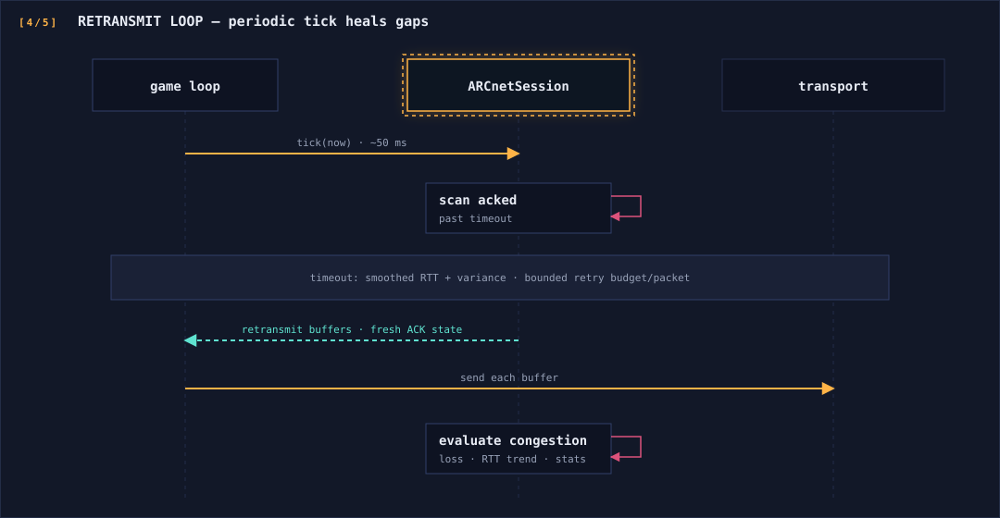
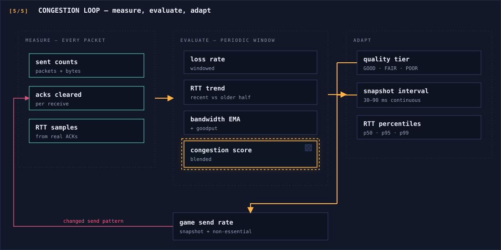

# ARCnet Architecture

ARCnet is a session-oriented reliability layer that sits between game logic and any byte transport. This document describes the system's structure and data flows. Wire-format specifics and the novel algorithms (FEC construction, congestion scoring, retransmit policy) are described conceptually — the implementations are proprietary.

## Layer Stack

The core design rule: **ARCnet never touches a socket.** It consumes and produces `ArrayBuffer`s; everything above and below it is swappable.



Each channel owns an independent 16-bit sequence space and its own delivery semantics, so a burst of volatile cosmetic traffic can never stall critical match events.

## Packet Anatomy (conceptual)

Every packet carries a small fixed header ahead of the payload:

- a **magic byte** so ARCnet frames are cheaply distinguishable from raw application data sharing the same transport;
- a packed field encoding the **channel**, the **packet kind** (normal data, FEC parity, ACK-only, or control), and a **wire version** so decoders reject unknown formats cleanly;
- the packet's **per-channel sequence number**;
- **piggybacked ACK state**: the highest sequence received from the peer plus a selective-ACK bitfield covering a window of recent packets.

Because ACK state rides on every packet, two-way traffic needs no dedicated ACK packets. A peer that only receives acked traffic answers with **ACK-only** packets instead: the header alone, carrying its ACK state for that channel, with no sequence of its own, never tracked and never retransmitted. A lost one is answered by the sender's retransmit, which makes the next one due. Receivers that predate the kind apply the ACKs and see an empty payload, so the change was deployable from either side.

## Send Path



The sender is synchronous and allocation-light: one call returns the exact buffers to put on the wire. On FEC-enabled channels, every N-th send additionally yields one parity packet protecting the just-completed group.

## Receive Path — ACK, Delivery, and FEC Recovery



Properties worth noting:

- **Recovery is bidirectional.** A parity arriving before its data packets is held; a data packet arriving later can complete the group and trigger recovery. Either arrival order heals the loss.
- **Recovered packets are first-class.** They re-enter the same channel state machine under their original sequence number, so ordering and ACK bookkeeping stay consistent. Bounded caches (recent-data and pending-parity stores with FIFO eviction) keep memory flat under sustained loss.
- **ACK-only packets stop after the ACK step.** Their acknowledgements are applied like any other packet's; then the packet ends there, with nothing to deliver.
- **Ordered delivery survives a bad start and a dead hole.** A fresh stream waits for its true first packet even when a later one arrives first; a receiver that joins mid-stream starts where it joined. A hole the sender has stopped retransmitting is given up after a few seconds and delivery resumes at the oldest waiting packet. The check runs on every receive, so a receive-only peer that never ticks still releases those events on time.
- **Receive-side loss is counted as packets arrive.** The sequenced channel tracks how many packets arrived as the newest and how many sequence numbers were skipped, so loss over any window is available without a tick.

## Retransmit Loop

Acked channels keep unacknowledged packets in a pending map. A periodic `tick()`:



Retransmits are re-encoded with *current* ACK state, so even a retransmission carries fresh acknowledgement information. Packets exceeding the retry budget are dropped rather than retried forever; the receiver's hole give-up (above) is the other half of that contract.

## Congestion Control Loop

The controller is designed as a closed loop between measurement and the game's send rate:



Key ideas, conceptually:

- **Trend, not just level.** Comparing recent RTT samples against older ones detects queue buildup *before* loss occurs, so throttling can begin early.
- **Continuous output.** The blended congestion score maps onto a smooth recommended snapshot interval rather than discrete steps, avoiding oscillation and visible rate "gear shifts." The discrete tier remains available for simple branching.
- **Honest loss.** Only acked channels count toward the sender's loss rate, since a latest-wins stream is never acknowledged and would read as near-total loss. RTT is taken from whichever acked channel the peer is acknowledging.
- **Honest tail latency.** Percentile RTT (p50/p95/p99) is computed from the live sample window — the p95/p99 signals are there for interpolation-buffer sizing on jittery mobile links where averages are misleading.

Arcbound leaves the loop open today: it sends snapshots at a fixed ~33 Hz (an early adaptive-rate trial starved clients), and it sizes its interpolation delay from its own per-snapshot lateness samples rather than from the RTT percentiles.

## Transport Abstraction

The integration contract is deliberately minimal — a transport only needs to move buffers:

```ts
interface ByteTransport {
  send(buf: ArrayBuffer): void;
  onMessage(handler: (buf: ArrayBuffer) => void): void;
}

function bind(session: ARCnetSession, t: ByteTransport) {
  t.onMessage((buf) => {
    for (const b of unbatch(buf)) {           // transparently split coalesced bundles
      const delivered = session.receive(b);
      if (delivered) dispatch(delivered);
      else handleRaw(b);                       // non-ARCnet traffic passes through
    }
    for (const a of session.takeAcks()) t.send(a); // owed ACKs, for a receive-only peer
  });
}
```

Because `receive()` returns `null` for non-ARCnet buffers, the protocol can share a transport with legacy or out-of-band messages — which is how it was rolled into a live game incrementally. Arcbound still uses that today: the server's snapshots and match events are ARCnet-framed over WebRTC DataChannels, while the client sends its inputs and fire events over the same WebRTC connection as raw codec packets, and its only framed traffic is ACK-only replies. The repo's Discord Activity example demonstrates the transport payoff: the entire adaptation is a one-time transport-level URL re-mapping through Discord's proxy plus an identity handshake; the protocol layer is byte-for-byte identical to the standalone web build. (Arcbound's own Discord build currently plays over its WebSocket path, which carries snapshots without ARCnet framing.)

## Companion Codec

Alongside ARCnet, a packed binary codec encodes per-tick input and fire events at an 80–85% size reduction versus JSON. Each encoding leads with a distinct tag byte, chosen not to collide with JSON or other binary message types on the same channel, so receivers branch cheaply and fall back to JSON for anything untagged. The codec is an application-level pattern — its field layout is game-specific by design.

Since v3.2 an input may carry its **sample time**: when its position was true on the sender's clock. A receiver maps the sender's clock onto its own with the fastest recent delivery (the smallest arrival-minus-sample-time offset over a short rolling window), places each position at that mapped time, never later than its arrival, and re-anchors after a large jump such as a suspended tab. Positions keep the sender's real spacing through jitter and bursts instead of clumping at arrival. Old decoders read the extended packet unchanged, and an input sent without a time is the old packet byte for byte.

## Payload Evolution (Arcbound)

Arcbound's state snapshot, the payload ARCnet carries most, evolves per connection rather than by flag day:

- **Capability handshake.** The first message on every connection says which snapshot format the client decodes; the server encodes per client from the next broadcast. Silence means the original format, so client and server deploy in either order.
- **Formats.** v2 sends numeric projectile ids and fixed-point positions; v3 adds keep-alive projectiles, sending a long-lived bouncing shot in full only when new, after a bounce or on a slow resync, and otherwise just its id.
- **Skippable sections.** Extensions ride tagged, length-prefixed sections after the core record, so an older decoder skips what it does not know instead of misreading everything after it.
